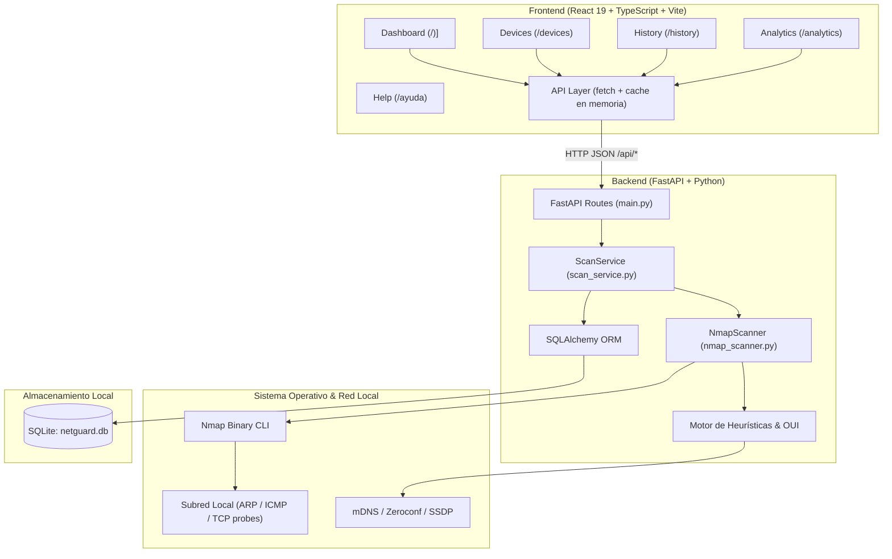

# 01 - Visión General y Arquitectura del Sistema

## 1. Propósito de NetGuard
NetGuard es una solución de monitoreo de red e inventario de ciberseguridad diseñada para redes locales privadas y autorizadas. Su objetivo es proporcionar visibilidad completa de los equipos conectados, alertar sobre intrusiones o dispositivos no autorizados y evaluar la superficie de ataque mediante el análisis de puertos y servicios abiertos.

### Casos de Uso Clave
- **Inventario Automatizado**: Descubrimiento dinámico de hosts en la subred local mediante ARP/Nmap y mDNS/Bonjour.
- **Detección de Intrusos / Equipos Nuevos**: Clasificación de dispositivos en "Conocidos / Confiables" (*trusted*) y "Nuevos / No confiables" (*untrusted*).
- **Análisis de Vulnerabilidad y Puertos Sensibles**: Identificación de servicios inseguros o críticos expuestos (FTP 21, Telnet 23, SSH 22, SMB 445, RDP 3389).
- **Auditoría Temporal**: Seguimiento de cuándo un dispositivo se conectó por primera vez (`first_seen`), su última conexión (`last_seen`) y si actualmente está activo (`is_present`).

---

## 2. Diagrama de Arquitectura

---

## 3. Normas de Calidad y Estándares Aplicados

En el código fuente se aplican explícitamente principios de:
- **ISO/IEC 25010** (Calidad de Producto de Software):
  - *Fiabilidad (Reliability)*: Transacciones con `rollback` automático en base de datos; manejo uniforme de excepciones a través de `NetGuardError`.
  - *Seguridad (Security)*: Manejo de errores no controlados sin filtrar detalles internos o trazas de pila al cliente HTTP.
  - *Eficiencia de Desempeño (Performance Efficiency)*: Tiempo límite de escaneo configurable (`DEFAULT_SCAN_TIMEOUT_SECONDS = 120`), registro estandarizado de métricas de duración por escaneo (**ISO/IEC 25023**).
- **IEEE 730**: Manejo de errores consistente y respuestas estructuradas con códigos claros (`INVALID_TARGET`, `NMAP_NOT_FOUND`, `SCAN_TIMEOUT`, `SCAN_FAILED`, `INTERNAL_ERROR`).
