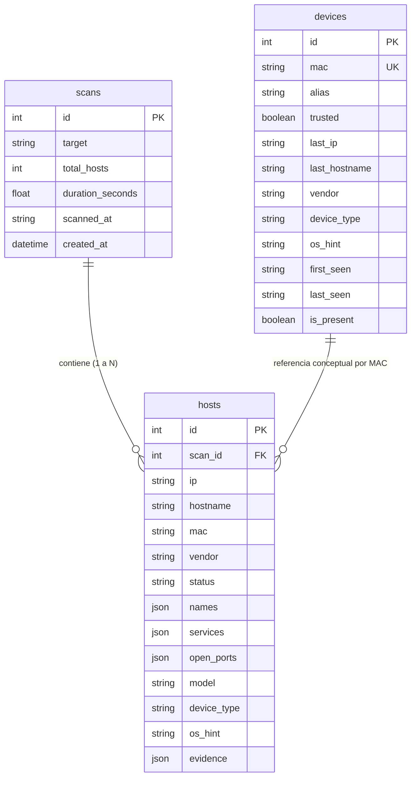

# 03 - Base de Datos y Modelos de Persistencia

## 1. Motor y Configuración

- **Motor:** SQLite con SQLAlchemy ORM.
- **Ubicación:** `backend/app/db/netguard.db`.
- **Configuración:** Modo `check_same_thread: False` para permitir concurrencia dentro de peticiones FastAPI.

---

## 2. Esquema de Entidades y Modelos (`app/db/models.py`)

El sistema distingue entre dos conceptos fundamentales:
1. **Instantánea de Escaneo (`scans` y `hosts`)**: Registra la foto exacta de un escaneo en un instante dado.
2. **Inventario Persistente (`devices`)**: Representa a un dispositivo físico único en la red, identificado por su dirección MAC.

---

## 3. Detalle de Tablas

### `scans` (`ScanRecord`)
* `id` (INTEGER, PK): Identificador único del escaneo.
* `target` (STRING): Red CIDR escaneada (ej. `192.168.0.0/24`).
* `total_hosts` (INTEGER): Cantidad total de hosts detectados arriba (`status == 'up'`).
* `duration_seconds` (FLOAT): Duración del escaneo en segundos (métrica de calidad ISO/IEC 25023).
* `scanned_at` (STRING): Marca temporal formateada de ejecución del escaneo.
* `created_at` (DATETIME): Timestamp del registro en la base de datos.
* **Relación:** `hosts` con eliminación en cascada (`cascade="all, delete-orphan"`).

### `hosts` (`HostRecord`)
* `id` (INTEGER, PK).
* `scan_id` (INTEGER, FK -> `scans.id`).
* `ip` (STRING): Dirección IP del host durante este escaneo.
* `hostname` (STRING): Nombre de host resuelto (DNS/NetBIOS/mDNS).
* `mac` (STRING): Dirección física MAC.
* `vendor` (STRING): Fabricante del adaptador de red (OUI).
* `status` (STRING): Estado del host (normalmente `up`).
* `names` (JSON): Lista de nombres adicionales encontrados por mDNS/zeroconf.
* `services` (JSON): Lista de servicios identificados.
* `open_ports` (JSON): Lista de números de puertos abiertos (ej. `[80, 443, 22]`).
* `model` (STRING): Modelo específico inferido (ej. "Apple TV 4K", "Chromecast").
* `device_type` (STRING): Categoría general (ej. "router", "camera", "mobile", "pc").
* `os_hint` (STRING): Sistema operativo inferido (ej. "Linux", "Windows", "iOS").
* `evidence` (JSON): Lista de evidencias técnicas usadas para la inferencia.

### `devices` (`DeviceRecord`)
* `id` (INTEGER, PK).
* `mac` (STRING, UNIQUE, INDEX): Clave única de hardware del dispositivo.
* **Campos editables por el usuario:**
  * `alias` (STRING): Nombre asignado manualmente por el usuario.
  * `trusted` (BOOLEAN): `True` si el usuario marcó el dispositivo como confiable, `False` por defecto.
* **Campos actualizados automáticamente en cada escaneo:**
  * `last_ip` (STRING): Última IP asignada observada.
  * `last_hostname` (STRING): Último hostname visto.
  * `vendor` (STRING): Fabricante OUI.
  * `device_type` (STRING): Tipo inferido.
  * `os_hint` (STRING): SO inferido.
* **Presencia y auditoría:**
  * `first_seen` (STRING): Fecha/hora del primer escaneo en que apareció.
  * `last_seen` (STRING): Fecha/hora del último escaneo en que apareció.
  * `is_present` (BOOLEAN): `True` si apareció en el escaneo más reciente; `False` si no respondió.

### `scan_tasks` (`ScanTaskRecord`)
* `id` (STRING, PK, UUID): Identificador único de la tarea asíncrona.
* `target` (STRING, nullable): Objetivo CIDR solicitado o `null` si fue autodetección.
* `status` (STRING, INDEX): Estado de la tarea (`pending`, `running`, `completed`, `failed`).
* `created_at` (DATETIME): Fecha/hora UTC de creación de la tarea.
* `started_at` (DATETIME, nullable): Fecha/hora UTC de inicio real de Nmap.
* `finished_at` (DATETIME, nullable): Fecha/hora UTC de finalización (exitosa o fallida).
* `scan_id` (INTEGER, FK -> `scans.id`, nullable): Enlace al resultado en `scans` una vez completada.
* `error_code` (STRING, nullable): Código de error estructurado si falló (`SCAN_TIMEOUT`, `NMAP_NOT_FOUND`, `SERVER_RESTARTED`, etc.).
* `error_message` (STRING, nullable): Mensaje descriptivo del fallo.
* **Relación:** `scan` (`ScanRecord`, lazy='joined') para embeber resultados sin duplicar datos.

---

## 4. Ciclo de Vida y Sincronización (`_upsert_devices`)

Al completarse un escaneo en `ScanService`:
1. Para cada host con dirección MAC:
   - Si no existe en `devices`: se crea un nuevo `DeviceRecord` con `first_seen = last_seen = scan_time`, `is_present = True` y `trusted = False`.
   - Si ya existe: se actualizan sus atributos (`last_ip`, `last_hostname`, `vendor`, `device_type`, `os_hint`, `last_seen = scan_time`, `is_present = True`). El `alias` y el flag `trusted` definidos por el usuario **se preservan intactos**.
2. Los dispositivos previamente registrados cuya MAC **no** apareció en el escaneo actual se actualizan con `is_present = False`.
